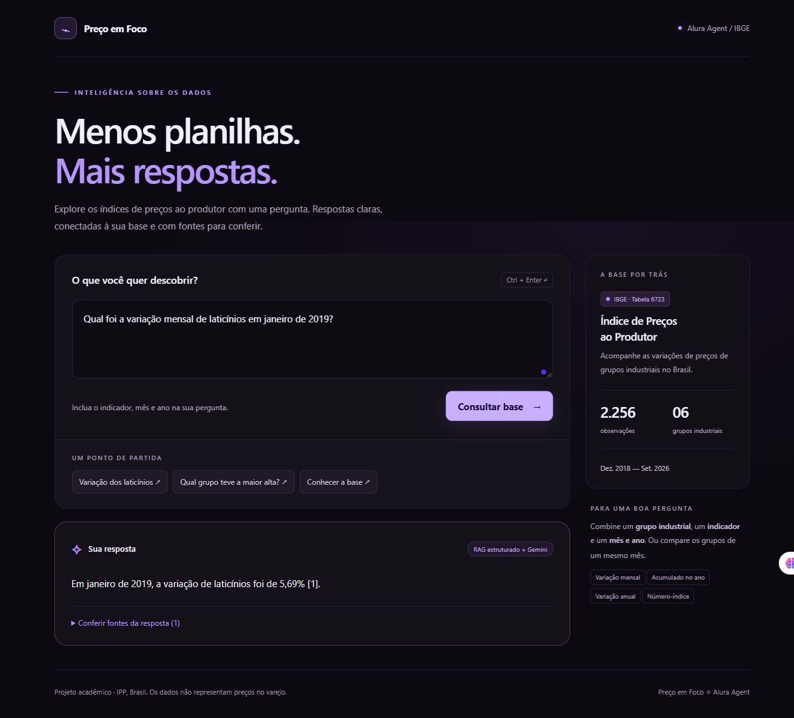
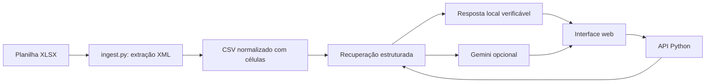

# Preço em Foco

**IA aplicada a dados públicos · Python · Gemini · Docker · Oracle Cloud Infrastructure**

[Aplicação na OCI](http://129.148.23.0:8000) · [Arquitetura](#arquitetura) · [Execução local](#execução-local) · [Exemplos](#perguntas-e-respostas-reproduzíveis)

Agente para consultar o Índice de Preços ao Produtor (IPP) do IBGE usando a planilha fornecida `IndicesPreços/IndicesPreços.xlsx`. Responde em português, apresenta valores e identifica as células de origem. Projeto desenvolvido para o Challenge Alura Agente.

## Visão geral

- Implementação local, conversão da base, interface web, testes e Docker disponíveis.
- Integração Gemini validada localmente em 08/11/2026 com `gemini-3.5-flash-lite` e uma pergunta real da base.
- Repositório público: [Assoridente/precoemfoco](https://github.com/Assoridente/precoemfoco), com histórico de desenvolvimento e versões publicadas.
- Aplicação publicada na OCI: **[abrir Preço em Foco](http://129.148.23.0:8000)**.
- Deploy validado em 08/11/2026: saúde da aplicação e pergunta real com resposta `RAG estruturado + Gemini` pelo endereço público.
- Hospedagem de demonstração em E3 Flex com créditos de avaliação. A máquina não é Always Free; a disponibilidade depende da avaliação e do saldo de créditos.

## Demonstração na OCI

[Aplicação pública](http://129.148.23.0:8000) · [Verificar saúde](http://129.148.23.0:8000/health) · [Registro da validação pública](docs/evidencias/validacao-oci.json)

Pergunta testada: **Qual grupo teve a maior variação mensal em janeiro de 2019?**

Resposta gerada pelo Gemini na VM: o destaque entre os valores disponíveis é o grupo **105 Laticínios, com 5,69%**, acompanhado das seis fontes usadas na comparação. O teste foi realizado por uma requisição HTTP externa à VM.

Infraestrutura: OCI Compute, região São Paulo, Ubuntu 24.04, `VM.Standard.E3.Flex`, 1 OCPU, 4 GB de RAM, Docker e porta pública TCP 8000. A configuração privada do Gemini fica fora do repositório e da imagem Docker.



Captura real da aplicação publicada. O [teste local anterior](docs/evidencias/teste-local.png) permanece disponível como registro de desenvolvimento.

O desligamento preventivo da VM está agendado para **15/11/2026 às 23h (Brasília)**. Depois dessa data, consulte as evidências ou execute o projeto localmente. Detalhes em [Deploy OCI](docs/OCI.md).

## Base documental

Documentação complementar:

- [Descrição da base e cenário do desafio](docs/BASE_DOCUMENTAL.md).
- [Dicionário de dados do CSV](docs/DICIONARIO_DE_DADOS.md).
- [FAQ e guia de perguntas](docs/FAQ.md).

Tabela 6723, Brasil, fonte indicada no próprio arquivo: IBGE — Índice de Preços ao Produtor. São 2.256 observações, 94 meses de dezembro de 2018 a setembro de 2026, seis grupos industriais e quatro indicadores:

| Tipo | Significado | Unidade |
| --- | --- | --- |
| mensal | Mês contra mês imediatamente anterior | % |
| acumulado_ano | Acumulado em relação a dezembro do ano anterior | % |
| anual | Mês contra mesmo mês do ano anterior | % |
| numero_indice | Base dezembro de 2018 = 100 | pontos |

Grupos: carnes (101), óleos e gorduras (104), laticínios (105), moagem e alimentos para animais (106), açúcar (107) e café (108). IPP não é preço de varejo, faturamento ou quantidade vendida. Não há atualização automática.

O conversor lê coordenadas reais e propaga o mês dos cabeçalhos mesclados. Preserva o texto original de cada observação. Símbolos de indisponibilidade não viram zero; `-` significa zero absoluto conforme a legenda da planilha. O CSV fica em UTF-8 e usa ponto decimal. O arquivo original permanece intacto.

## Arquitetura



A recuperação usa regras de linguagem e filtros exatos de indicador, mês, ano e grupo. Para maior/menor, compara todos os valores disponíveis do recorte e preserva empates. Isso evita depender de similaridade textual para encontrar números em tabelas. Com Gemini configurado, os registros recuperados são enviados ao modelo para redigir a resposta: RAG estruturado, sem banco vetorial ou LangChain. Não há execução de código gerado pelo modelo.

Sem Gemini, funciona como consulta determinística, **sem modelo de IA generativa**. Para demonstrar o componente de IA do desafio, configure e teste o Gemini. O painel sempre informa o modo usado, inclusive fallback caso o provedor falhe. As fontes são construídas pelo código; o texto do LLM ainda pode conter erros, devendo ser conferido nos valores exibidos.

## Tecnologias e organização

Python 3.10+, biblioteca padrão (`csv`, `zipfile`, XML, HTTP e `unittest`), HTML/CSS/JavaScript, API REST Gemini e Docker. Não há pacotes Python externos a instalar.

```text
agent.py                 recuperação e geração
app.py                   servidor web e API
ingest.py                conversão reproduzível XLSX → CSV
data/indices.csv         documento utilizado nas consultas
static/index.html        interface
tests/test_agent.py      testes da base e das respostas
docs/OCI.md              publicação e evidências
Dockerfile               execução em contêiner
.env.example             exemplo de configuração
```

## Execução local

Na pasta do projeto, com Python instalado:

```powershell
python ingest.py
Copy-Item .env.example .env
python -m unittest discover -s tests -v
python app.py
```

Abra [http://localhost:8000](http://localhost:8000). Em Linux, use `python3` e `cp .env.example .env`. A conversão só precisa ser repetida se a planilha mudar. Ela é específica para a estrutura fornecida, não um importador universal de planilhas.

Para ativar IA, obtenha uma chave no [Google AI Studio](https://aistudio.google.com/) e preencha `.env`:

```dotenv
GEMINI_API_KEY=sua_chave
GEMINI_MODEL=identificador_de_modelo_disponivel_na_sua_conta
PORT=8000
```

Escolha um modelo que suporte `generateContent`, conforme a [documentação oficial do Gemini](https://ai.google.dev/api/generate-content). Reinicie a aplicação. O modo exibido deve ser `RAG estruturado + Gemini`; se indicar indisponibilidade, confira chave, modelo, acesso de rede, quota e faturamento no provedor. As consultas e os registros recuperados serão enviados ao Google. Nunca publique `.env` ou a chave.

### API

`GET /health` retorna status e quantidade de registros. `POST /api/ask` recebe JSON:

```json
{"pergunta":"Qual foi a variação mensal de laticínios em janeiro de 2019?"}
```

Retorna `resposta`, `fontes` (incluindo valor original e célula) e `modo`.

## Perguntas e respostas reproduzíveis

Exemplos reais do modo local, cobertos pelos testes. A redação do Gemini pode variar.

**Qual foi a variação mensal de laticínios em janeiro de 2019?**

> 105 Laticínios — janeiro 2019: 5,69% [1].

Fonte: IBGE, tabela 6723, primeira aba, célula K6.

**Qual grupo teve a maior variação mensal em janeiro de 2019?**

> Destaque entre os valores disponíveis: 105 Laticínios (5,69%).

A aplicação também lista os seis valores usados na comparação, com suas fontes.

**Qual foi a variação mensal de laticínios em dezembro de 2018?**

> 105 Laticínios — dezembro 2018: indisponível (símbolo ...) [1].

**Qual a variação mensal em janeiro de 2040?**

> Não encontrei esse período na base. Consulte “Qual período e quais grupos existem na base?”.

Outras perguntas: “Qual o número-índice do café em setembro de 2026?”, “Qual a variação acumulada no ano do açúcar em dezembro de 2020?” e “Qual período e quais grupos existem na base?”.

## Escopo e limitações

Informe um mês e um ano por consulta e o indicador. Sem grupo específico, são retornados todos os seis grupos daquele mês. O sistema pede esclarecimento quando falta indicador ou período. Não calcula médias, previsões, correção monetária ou comparações entre datas; perguntas livres fora desse formato podem precisar ser reformuladas. Os testes verificam conversão, célula conhecida, valor indisponível, período inexistente, ranking completo e esclarecimento. Não validam respostas de uma API externa.

O servidor da biblioteca padrão é uma base acadêmica de demonstração. Para exposição pública contínua, adicione proxy HTTPS, autenticação, limite de requisições e monitoramento de custos; o endpoint público de perguntas pode consumir a quota da sua chave.

## Docker e OCI

```bash
docker build -t preco-em-foco .
docker run -d --name preco-em-foco --restart unless-stopped --env-file .env -p 8000:8000 preco-em-foco
```

Siga [o roteiro de deploy OCI](docs/OCI.md). Evidências da publicação:

- Repositório público: [Assoridente/precoemfoco](https://github.com/Assoridente/precoemfoco).
- URL pública na OCI: [Preço em Foco](http://129.148.23.0:8000).
- Captura da aplicação publicada: [print OCI](docs/evidencias/oci.png).
- Validação pública da API e resposta Gemini: [registro JSON](docs/evidencias/validacao-oci.json).
- Validação local com Gemini: **08/11/2026**, modelo `gemini-3.5-flash-lite`; resposta confirmada de 5,69% para a variação mensal de laticínios em janeiro de 2019.

## Desenvolvimento e versões

Consulte o [histórico de alterações](CHANGELOG.md) e as [versões publicadas](https://github.com/Assoridente/precoemfoco/tags) para acompanhar a evolução da base, da interface e do deploy.

Para contribuir, abra uma issue com o comportamento observado, a pergunta usada e o resultado esperado. Nunca inclua chaves ou arquivos de configuração privados.

